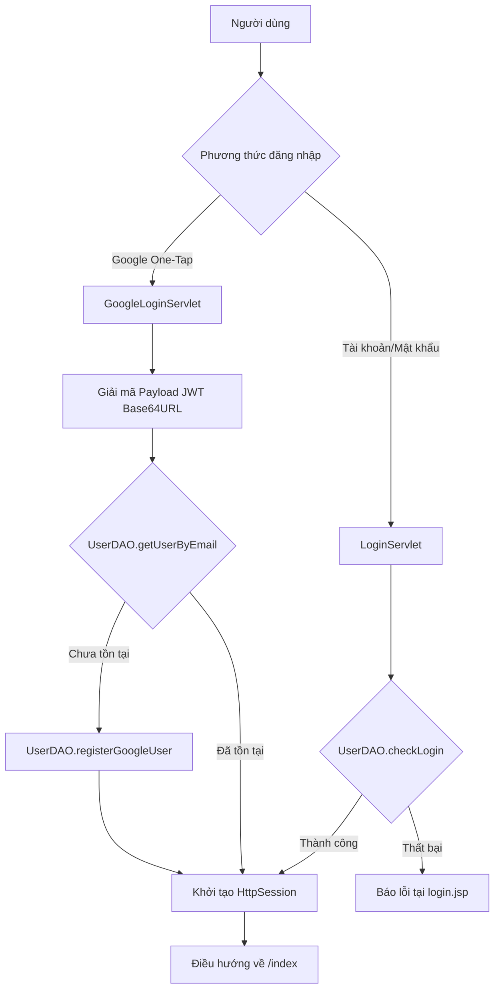
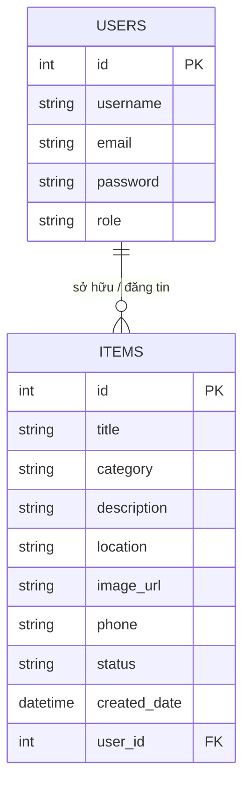

# OldThingsExchange - Nền Tảng Trao Đổi Đồ Cũ Sinh Viên PTIT

[](https://www.oracle.com/java/)
[](https://jakarta.ee/)
[](https://tomcat.apache.org/)
[](https://www.sqlite.org/)
[](https://maven.apache.org/)

---

## 1. Giới thiệu dự án
**OldThingsExchange** là hệ thống thông tin trao đổi và chia sẻ đồ dùng học tập nội bộ dành cho sinh viên Học viện Công nghệ Bưu chính Viễn thông (PTIT). Dự án giải quyết bài toán lãng phí tài nguyên (giáo trình, thiết bị, đồ dùng cá nhân) sau mỗi kỳ học, cung cấp không gian kết nối minh bạch, an toàn giữa người tặng/chuyển nhượng và người nhận, tối ưu chi phí và hỗ trợ thiết thực đời sống sinh viên.

## 2. Phân hệ chức năng & Ánh xạ Controller
Hệ thống gồm 3 phân hệ chức năng tương ứng với các Servlet xử lý:
- **Xác thực & Người dùng**: Đăng ký (`RegisterServlet`), đăng nhập truyền thống (`LoginServlet`), đăng nhập Google One-Tap (`GoogleLoginServlet`), đăng xuất (`LogoutServlet`), khôi phục mật khẩu (`ForgotPasswordServlet`), quản lý hồ sơ cá nhân (`ProfileServlet`).
- **Quản lý & Tương tác tin đăng**: Trang chủ, tìm kiếm từ khóa và lọc danh mục (`HomeServlet`), xem chi tiết tin (`ItemDetailServlet`), đăng tin kèm upload ảnh đa phương tiện (`AddItemServlet`), chỉnh sửa tin (`EditItemServlet`), xóa tin (`DeleteItemServlet`), danh sách tin cá nhân (`MyItemsServlet`), chuyển đổi trạng thái ACTIVE/DONE (`ToggleStatusServlet`).
- **Quản trị hệ thống (Admin)**: Thống kê tổng số lượng bài đăng và tài khoản, phân quyền quản trị viên, xóa tin đăng vi phạm quy định (`AdminServlet`).

## 3. Ngăn xếp công nghệ
- **Nền tảng & Ngôn ngữ**: Java 17 LTS, Jakarta EE 10 (Jakarta Servlet 6.0, Jakarta Server Pages JSP, JSTL 3.0 / GlassFish 3.0.1).
- **Máy chủ ứng dụng**: Apache Tomcat 10.1+.
- **Hệ quản trị CSDL**: SQLite 3 qua trình điều khiển `sqlite-jdbc` (v3.50.3.0), thao tác dữ liệu thông qua JDBC `PreparedStatement`.
- **Dịch vụ định danh**: Google Identity Services (Sign-In with Google / One-Tap JavaScript SDK).
- **Công cụ quản lý & Đóng gói**: Apache Maven 3.x (Web Application Archive - `OldThingsExchange.war`).
- **Giao diện**: HTML5, CSS3 Responsive, JSTL core tags.

## 4. Kiến trúc hệ thống và Tổ chức mã nguồn
Hệ thống thiết kế theo mô hình phân lớp **MVC (Model - View - Controller)**:
- **View**: Tập hợp các trang JSP (`src/main/webapp/*.jsp`) chịu trách nhiệm biểu diễn dữ liệu và tiếp nhận tương tác người dùng.
- **Controller**: Các Jakarta Servlet (`com.oldthings.servlet`) tiếp nhận request, kiểm soát trạng thái phiên (Session) và điều hướng.
- **Model & DAO**: Thực thể nghiệp vụ (`com.oldthings.model`) và tầng truy xuất dữ liệu (`com.oldthings.dao`) cách ly toàn bộ mã SQL.

```
OldThingsExchange/
├── src/main/java/com/oldthings/
│   ├── dao/         # Tầng truy xuất dữ liệu: UserDAO, ItemDAO
│   ├── filter/      # Bộ lọc kiểm soát HTTP: CacheFilter (chống lưu bộ nhớ đệm)
│   ├── model/       # Thực thể dữ liệu: User, Item
│   ├── servlet/     # Bộ điều hướng nghiệp vụ Controller (14 Servlets)
│   └── util/        # Tiện ích hệ thống: DBContext (quản lý kết nối SQLite)
├── src/main/webapp/ # Giao diện JSP, css/, images/, WEB-INF/web.xml
└── pom.xml          # Quản lý dependency và cấu hình build WAR
```

## 5. Phân hệ Xác thực, Phân quyền & Quản lý người dùng
- **Xác thực biểu mẫu truyền thống**: `LoginServlet` kiểm tra thông tin đăng nhập qua `UserDAO.checkLogin` (chấp nhận cả username hoặc email). Khi xác thực thành công, đối tượng `User` được lưu trữ trong `HttpSession` (`session.setAttribute("user", user)`).
- **Tích hợp Google One-Tap**: Client tích hợp Google Identity Services; sau khi người dùng xác thực với Google, client gửi JWT credential tới `GoogleLoginServlet`. Servlet tiến hành giải mã Base64 URL payload để lấy `email` và `name`. Nếu tài khoản chưa tồn tại, `UserDAO.registerGoogleUser` tự động tạo tài khoản với mật khẩu định danh `"GOOGLE_AUTH"` và username tự sinh duy nhất.
- **Khôi phục mật khẩu & Quản lý hồ sơ**: `ForgotPasswordServlet` thực hiện xác minh đối khớp đồng thời cả `username` và `email` trước khi cập nhật mật khẩu mới. `ProfileServlet` cho phép sửa username, email (có cơ chế tiền kiểm tra chống trùng lặp dữ liệu) và đổi mật khẩu (kiểm tra mật khẩu cũ; người dùng Google được phép thiết lập mật khẩu trực tiếp).
- **Đăng xuất & Bộ lọc CacheFilter**: `LogoutServlet` thực hiện hủy phiên (`session.invalidate()`). Để ngăn chặn nguy cơ truy cập dữ liệu nhạy cảm qua nút Back của trình duyệt sau khi đăng xuất, `CacheFilter` áp dụng trên các route riêng tư (`/admin`, `/my-items`, `/profile`) với các chỉ thị HTTP: `Cache-Control: no-cache, no-store, must-revalidate`, `Pragma: no-cache` và `Expires: 0`.
- **Kiểm soát phân quyền (RBAC)**: Phân định vai trò `USER` và `ADMIN` qua thuộc tính `role` kết hợp đối chiếu danh sách email quản trị viên đặc quyền.



## 6. Thiết kế Cơ sở dữ liệu
Hệ thống sử dụng SQLite với 2 bảng quan hệ 1-N (`users` - `items`):
- **users**: `id` (INTEGER PK AUTOINCREMENT), `username` (TEXT), `email` (TEXT), `password` (TEXT), `role` (TEXT DEFAULT 'USER').
- **items**: `id` (INTEGER PK AUTOINCREMENT), `title` (TEXT NOT NULL), `category` (TEXT NOT NULL), `description` (TEXT), `location` (TEXT), `image_url` (TEXT), `phone` (TEXT), `status` (TEXT DEFAULT 'ACTIVE'), `created_date` (DATETIME DEFAULT CURRENT_TIMESTAMP), `user_id` (INTEGER FK tham chiếu `users.id`).



## 7. Triển khai & Môi trường thực nghiệm
### Yêu cầu môi trường vận hành
- Java Development Kit (JDK): Phiên bản 17 LTS trở lên.
- Servlet Container: Apache Tomcat 10.1.x (chuẩn Jakarta EE 10 / Servlet 6.0).
- Công cụ biên dịch: Apache Maven 3.8+.

### Cấu hình hệ thống & Tham số tích hợp
- **Google OAuth 2.0 Client ID**: Cấu hình thuộc tính `data-client_id` tại view `src/main/webapp/login.jsp`. Ứng dụng chạy theo cơ chế Client-side Web App, không lưu trữ thông tin bí mật (Client Secret) trên mã nguồn.
- **Đường dẫn CSDL SQLite**: Lớp `DBContext` hỗ trợ cơ chế phân giải linh hoạt: ưu tiên biến môi trường `OLDTHINGS_DB_PATH`, tự động nhận diện thư mục Tomcat (`catalina.base`), hoặc fallback tại thư mục gốc ứng dụng. Schema được tự động đồng bộ khi khởi chạy.

### Quy trình đóng gói và Chạy ứng dụng
1. Đóng gói dự án qua Maven: `mvn clean package` (sinh tệp `target/OldThingsExchange.war`).
2. Triển khai tệp `.war` lên Tomcat Webapps hoặc chạy thông qua trình khởi chạy Tomcat Server trong IDE.
3. Điểm truy cập mặc định: `http://localhost:8080/OldThingsExchange/` (hoặc `http://localhost:8080/`).

## 8. Đánh giá An toàn thông tin & Hướng phát triển
- **Mật mã học**: Chuyển đổi lưu trữ mật khẩu từ văn bản thuần sang băm có muối (Salted Hashing) với BCrypt hoặc Argon2.
- **Xác thực chữ ký JWT**: Thay thế giải mã Base64 URL đơn thuần bằng thư viện `GoogleIdTokenVerifier` để xác thực chữ ký số mật mã học từ máy chủ Google.
- **Khôi phục mật khẩu an toàn**: Ứng dụng cơ chế mã xác thực một lần (OTP) hoặc liên kết đặt lại mật khẩu có thời hạn gửi qua giao thức SMTP.
- **Toàn vẹn dữ liệu**: Bổ sung ràng buộc `UNIQUE` cho `username`, `email` trực tiếp tại DDL cơ sở dữ liệu và thêm trường `auth_provider`.
- **Kiểm soát tấn công**: Triển khai cơ chế giới hạn tần suất đăng nhập (Rate Limiting) phòng chống tấn công dò mật khẩu (Brute-force).

## 9. Phân công nhiệm vụ thành viên
| STT | Họ và tên | Mã sinh viên | Phân hệ phụ trách |
|:---:|:---|:---:|:---|
| 1 | Hà Xuân Phong | B24DCCN438 | Thiết kế Cơ sở dữ liệu & Phân hệ Khám phá (Trang chủ, Tìm kiếm, Lọc hàng hóa) |
| 2 | Vũ Trung Kiên | B24DCCN335 | Phân hệ Xác thực, Bảo mật tài khoản & Tích hợp Google Identity Services (Sign-in) |
| 3 | Nguyễn Đức Mạnh | B24DCCN382 | Phân hệ Đăng tin, Quản lý kho đồ cá nhân & Xử lý Upload ảnh đa phương tiện |
| 4 | Phạm Yên Hưng | B24DCCN265 | Phân hệ Quản trị viên (Admin), Phân quyền, Bộ lọc bảo mật (CacheFilter) & Giao diện |
