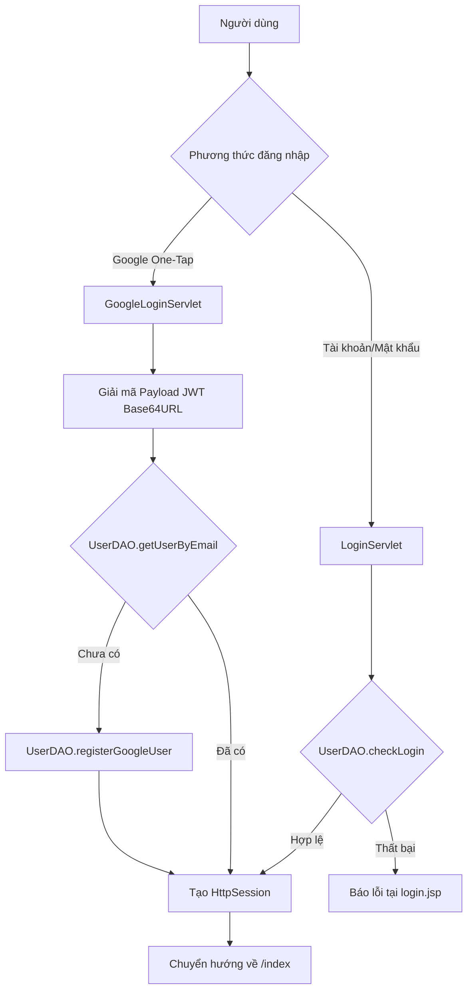
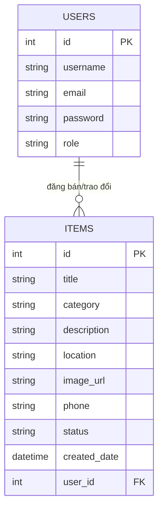

# OldThingsExchange - Nền Tảng Trao Đổi Đồ Cũ Sinh Viên PTIT

[](https://www.oracle.com/java/)
[](https://jakarta.ee/)
[](https://tomcat.apache.org/)
[](https://www.sqlite.org/)
[](https://maven.apache.org/)

---

## 1. Giới thiệu dự án
**OldThingsExchange** là ứng dụng web trao đổi đồ dùng nội bộ dành riêng cho sinh viên Học viện Công nghệ Bưu chính Viễn thông (PTIT). Dự án giải quyết nhu cầu thanh lý, cho tặng giáo trình, đồ dùng học tập và thiết bị cá nhân đã qua sử dụng, giúp sinh viên tiết kiệm chi phí, tối ưu tài nguyên và xây dựng lối sống bền vững.

## 2. Chức năng chính theo module
Dự án được phân chia thành 3 phân hệ chức năng dựa trên các Servlet thực tế:
- **Người dùng & Xác thực**: Đăng ký tài khoản (`RegisterServlet`), đăng nhập truyền thống (`LoginServlet`), đăng nhập Google One-Tap (`GoogleLoginServlet`), đăng xuất (`LogoutServlet`), quên mật khẩu (`ForgotPasswordServlet`), quản lý thông tin cá nhân (`ProfileServlet`).
- **Tin đăng & Trao đổi**: Duyệt trang chủ, tìm kiếm theo từ khóa và lọc danh mục (`HomeServlet`), xem chi tiết tin đăng (`ItemDetailServlet`), đăng tin mới có upload ảnh (`AddItemServlet`), chỉnh sửa tin (`EditItemServlet`), xóa tin (`DeleteItemServlet`), xem danh sách tin cá nhân (`MyItemsServlet`), bật/tắt trạng thái ACTIVE/DONE (`ToggleStatusServlet`).
- **Quản trị hệ thống (Admin)**: Xem thống kê tổng bài đăng và thành viên, phân quyền tài khoản thành Admin, xóa bài đăng vi phạm (`AdminServlet`).

## 3. Công nghệ sử dụng
- **Ngôn ngữ & Nền tảng**: Java 17, Jakarta EE 10 (Jakarta Servlet 6.0, Jakarta Server Pages JSP, JSTL 3.0).
- **Web Server**: Apache Tomcat 10.1+.
- **Cơ sở dữ liệu**: SQLite 3 qua thư viện `sqlite-jdbc` (v3.50.3.0), thao tác bằng JDBC PreparedStatement.
- **Xác thực ngoài**: Google Identity Services (Sign-In with Google / One-Tap JavaScript SDK).
- **Công cụ build**: Apache Maven 3.x (đóng gói tệp WAR: `OldThingsExchange.war`).
- **Giao diện**: HTML5, CSS3 Responsive, JSTL core tags.

## 4. Kiến trúc và Cấu trúc thư mục
Hệ thống áp dụng mô hình kiến trúc **MVC (Model - View - Controller)**:
- **View**: Các trang JSP (`src/main/webapp/*.jsp`) render giao diện và nhận tương tác từ người dùng.
- **Controller**: Các Servlet (`com.oldthings.servlet`) tiếp nhận request, kiểm tra phiên (Session) và điều hướng.
- **Model & DAO**: Thực thể dữ liệu (`com.oldthings.model`) và lớp thao tác CSDL (`com.oldthings.dao`) tách biệt mã SQL.

```
OldThingsExchange/
├── src/main/java/com/oldthings/
│   ├── dao/         # Truy vấn CSDL: UserDAO, ItemDAO
│   ├── filter/      # Bộ lọc HTTP: CacheFilter (chống cache lịch sử)
│   ├── model/       # Thực thể dữ liệu: User, Item
│   ├── servlet/     # Điều hướng Controller (14 Servlets)
│   └── util/        # Tiện ích: DBContext (kết nối SQLite)
├── src/main/webapp/ # Giao diện JSP, css/, images/, WEB-INF/web.xml
└── pom.xml          # Cấu hình dependency Maven và build WAR
```

## 5. Phân hệ Quản lý người dùng và Xác thực
- **Đăng ký & Đăng nhập thường**: `LoginServlet` xác thực qua `UserDAO.checkLogin` (chấp nhận cả username hoặc email). Khi hợp lệ, thông tin được ghi nhận vào `HttpSession` (`session.setAttribute("user", user)`).
- **Đăng nhập Google One-Tap**: Tích hợp Google Identity Services ở frontend; khi người dùng chọn tài khoản, Google gửi về JWT credential. `GoogleLoginServlet` giải mã Base64 URL payload để lấy `email` và `name`. Nếu email chưa tồn tại, `UserDAO.registerGoogleUser` sẽ tự động tạo tài khoản với mật khẩu mặc định `"GOOGLE_AUTH"` và sinh username duy nhất.
- **Quên mật khẩu & Hồ sơ**: `ForgotPasswordServlet` kiểm tra khớp đồng thời cả `username` và `email` trước khi đổi mật khẩu mới. `ProfileServlet` hỗ trợ cập nhật username, email (kiểm tra chống trùng lặp trong CSDL) và đổi mật khẩu (kiểm tra mật khẩu cũ; hỗ trợ user Google thiết lập mật khẩu mới).
- **Đăng xuất & CacheFilter**: `LogoutServlet` hủy phiên (`session.invalidate()`) và xóa cache trình duyệt. `CacheFilter` áp dụng trên các route riêng tư (`/admin`, `/my-items`, `/profile`) với header `Cache-Control: no-cache, no-store, must-revalidate`, ngăn trình duyệt dùng nút Back hiển thị lại dữ liệu sau khi đăng xuất.
- **Phân quyền**: Quản lý qua trường `role` (`USER`/`ADMIN`) và danh sách email Admin quản trị viên định sẵn.



## 6. Cơ sở dữ liệu
Hệ thống sử dụng SQLite với 2 bảng quan hệ 1-N:
- **users**: `id` (INTEGER PK), `username` (TEXT), `email` (TEXT), `password` (TEXT), `role` (TEXT DEFAULT 'USER').
- **items**: `id` (INTEGER PK), `title` (TEXT NOT NULL), `category` (TEXT NOT NULL), `description` (TEXT), `location` (TEXT), `image_url` (TEXT), `phone` (TEXT), `status` (TEXT DEFAULT 'ACTIVE'), `created_date` (DATETIME), `user_id` (INTEGER FK tham chiếu `users.id`).



## 7. Hướng dẫn cài đặt và vận hành
### Yêu cầu môi trường
- JDK 17 trở lên.
- Apache Tomcat 10.1.x (tương thích Jakarta Servlet 6.0).
- Apache Maven 3.8+ và IDE (IntelliJ IDEA / Eclipse).

### Cấu hình Google Client ID và CSDL
1. Tạo OAuth 2.0 Client ID tại Google Cloud Console (Web application).
2. Mở file `src/main/webapp/login.jsp`, tìm thuộc tính `data-client_id` và thay bằng Client ID của bạn *(Tuyệt đối không lưu mã bí mật Client Secret vào mã nguồn)*.
3. CSDL SQLite (`oldthings.db`) tự động sinh bảng khi khởi chạy hoặc có thể chỉ định đường dẫn qua biến môi trường `OLDTHINGS_DB_PATH`.

### Các bước chạy
1. Biên dịch và đóng gói: `mvn clean package` (tạo file `target/OldThingsExchange.war`).
2. Deploy file WAR vào thư mục `webapps/` của Tomcat hoặc cấu hình chạy trực tiếp trên Tomcat Server trong IDE.
3. Khởi động Tomcat và truy cập: `http://localhost:8080/OldThingsExchange/` (hoặc `http://localhost:8080/`).

## 8. Hướng phát triển và Cải tiến bảo mật
- **Mã hóa mật khẩu**: Sử dụng thuật toán băm an toàn BCrypt / Argon2 thay cho mật khẩu plain-text hiện tại.
- **Xác thực Google JWT**: Sử dụng thư viện `GoogleIdTokenVerifier` để kiểm tra chữ ký số mật mã học thay cho việc chỉ giải mã Base64 URL payload.
- **Khôi phục mật khẩu**: Gửi mã xác nhận OTP hoặc liên kết đặt lại mật khẩu có thời hạn qua email người dùng.
- **Ràng buộc CSDL**: Thêm ràng buộc `UNIQUE` cho `username`, `email` trong DDL và bổ sung cột `auth_provider` (`LOCAL`/`GOOGLE`).
- **Chống Brute-force**: Giới hạn tần suất đăng nhập sai (Rate Limiting) và bổ sung mã xác thực CAPTCHA.

## 9. Thành viên thực hiện và Phân công
| STT | Họ và tên | MSSV | Phụ trách |
|:---:|:---|:---:|:---|
| 1 | | | |
| 2 | | | |
| 3 | | | |
